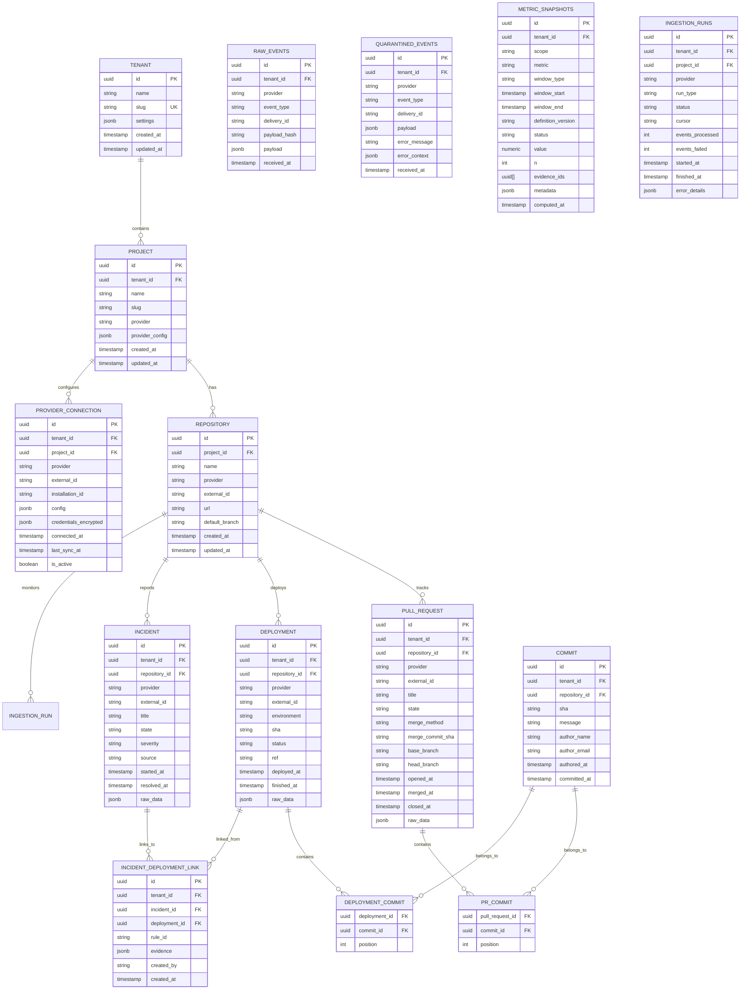

# DORA Platform — Data Model

**Status:** Phase 1 — Accepted
**Date:** 2026-10-28

---

## Entity-Relationship Diagram



---

## Table Conventions

Every table follows these conventions:

| Convention | Implementation |
|------------|----------------|
| Primary Key | `id` UUID (UUIDv4, generated by application) |
| Tenant Isolation | `tenant_id` UUID NOT NULL on every table |
| Timestamps | `created_at` / `updated_at` `timestamptz` (UTC), server defaults |
| Provider Sourcing | `UNIQUE (tenant_id, provider, external_id)` on provider-sourced rows |
| Foreign Keys | Explicit FK constraints with `ON DELETE CASCADE` where appropriate |
| Soft Deletes | Not used — hard deletes with cascade |

---

## Core Tables

### `tenants`
Root of the tenancy hierarchy. One tenant = one isolated data domain.

| Column | Type | Constraints |
|--------|------|-------------|
| id | UUID | PK |
| name | VARCHAR(255) | NOT NULL |
| slug | VARCHAR(100) | NOT NULL, UNIQUE |
| settings | JSONB | NOT NULL, DEFAULT '{}' |
| created_at | TIMESTAMPTZ | NOT NULL, DEFAULT now() |
| updated_at | TIMESTAMPTZ | NOT NULL, DEFAULT now() |

### `projects`
Logical grouping within a tenant (e.g., a course/cohort). Maps to a GitHub org or GitLab group.

| Column | Type | Constraints |
|--------|------|-------------|
| id | UUID | PK |
| tenant_id | UUID | NOT NULL, FK → tenants.id |
| name | VARCHAR(255) | NOT NULL |
| slug | VARCHAR(100) | NOT NULL |
| provider | VARCHAR(50) | NULL (github \| gitlab) |
| provider_config | JSONB | NOT NULL, DEFAULT '{}' |
| created_at | TIMESTAMPTZ | NOT NULL, DEFAULT now() |
| updated_at | TIMESTAMPTZ | NOT NULL, DEFAULT now() |

**Unique Constraint:** `(tenant_id, slug)` — `uq_projects_tenant_slug`

---

### `repositories`
Individual repository within a project.

| Column | Type | Constraints |
|--------|------|-------------|
| id | UUID | PK |
| project_id | UUID | NOT NULL, FK → projects.id |
| name | VARCHAR(255) | NOT NULL |
| provider | VARCHAR(50) | NOT NULL (github \| gitlab) |
| external_id | VARCHAR(255) | NOT NULL |
| url | VARCHAR(500) | NOT NULL |
| default_branch | VARCHAR(100) | NOT NULL, DEFAULT 'main' |
| created_at | TIMESTAMPTZ | NOT NULL, DEFAULT now() |
| updated_at | TIMESTAMPTZ | NOT NULL, DEFAULT now() |

**Unique Constraint:** `(project_id, provider, external_id)` — `uq_repositories_project_provider_external`

**Indexes:**
- `ix_repositories_project_provider` on `(project_id, provider)`

---

## Provider Integration Tables

### `provider_connections`
Stores authenticated provider connections (GitHub App installations, GitLab tokens).

| Column | Type | Constraints |
|--------|------|-------------|
| id | UUID | PK |
| tenant_id | UUID | NOT NULL, FK → tenants.id |
| project_id | UUID | NOT NULL, FK → projects.id |
| provider | VARCHAR(50) | NOT NULL (github \| gitlab) |
| external_id | VARCHAR(255) | NOT NULL (installation ID, project/group ID) |
| installation_id | VARCHAR(255) | NULL (GitHub App installation ID) |
| config | JSONB | NOT NULL, DEFAULT '{}' |
| credentials_encrypted | JSONB | NULL (encrypted tokens/keys) |
| connected_at | TIMESTAMPTZ | NOT NULL, DEFAULT now() |
| last_sync_at | TIMESTAMPTZ | NULL |
| is_active | BOOLEAN | NOT NULL, DEFAULT true |

**Unique Constraint:** `(tenant_id, provider, external_id)` — `uq_provider_connections_tenant_provider_external`

---

## Ingestion Tables

### `raw_events`
Append-only log of every webhook payload received. Never modified after insert.

| Column | Type | Constraints |
|--------|------|-------------|
| id | UUID | PK |
| tenant_id | UUID | NOT NULL, FK → tenants.id |
| provider | VARCHAR(50) | NOT NULL (github \| gitlab) |
| event_type | VARCHAR(100) | NOT NULL (e.g., `pull_request`, `deployment`) |
| delivery_id | VARCHAR(255) | NOT NULL (GitHub `X-GitHub-Delivery`, GitLab `X-Gitlab-Delivery`) |
| payload_hash | VARCHAR(64) | NOT NULL (SHA-256 of raw payload) |
| payload | JSONB | NOT NULL |
| received_at | TIMESTAMPTZ | NOT NULL, DEFAULT now() |

**Unique Constraint:** `(tenant_id, provider, delivery_id)` — `uq_raw_events_tenant_provider_delivery`

**Indexes:**
- `ix_raw_events_tenant_received` on `(tenant_id, received_at)`

---

### `quarantined_events`
Events that failed normalization (malformed, unknown shape, parsing error). Never crash the worker.

| Column | Type | Constraints |
|--------|------|-------------|
| id | UUID | PK |
| tenant_id | UUID | NOT NULL, FK → tenants.id |
| provider | VARCHAR(50) | NOT NULL |
| event_type | VARCHAR(100) | NOT NULL |
| delivery_id | VARCHAR(255) | NOT NULL |
| payload | JSONB | NOT NULL |
| error_message | TEXT | NOT NULL |
| error_context | JSONB | NOT NULL, DEFAULT '{}' |
| received_at | TIMESTAMPTZ | NOT NULL, DEFAULT now() |

---

## Normalized Domain Tables

### `pull_requests`
Provider-neutral representation of PRs/MRs.

| Column | Type | Constraints |
|--------|------|-------------|
| id | UUID | PK |
| tenant_id | UUID | NOT NULL, FK → tenants.id |
| repository_id | UUID | NOT NULL, FK → repositories.id |
| provider | VARCHAR(50) | NOT NULL (github \| gitlab) |
| external_id | VARCHAR(255) | NOT NULL (PR/MR number) |
| title | VARCHAR(500) | NOT NULL |
| state | VARCHAR(50) | NOT NULL (open, closed, merged) |
| merge_method | VARCHAR(50) | NULL (merge, squash, rebase) |
| merge_commit_sha | VARCHAR(40) | NULL |
| base_branch | VARCHAR(255) | NOT NULL |
| head_branch | VARCHAR(255) | NOT NULL |
| opened_at | TIMESTAMPTZ | NOT NULL |
| merged_at | TIMESTAMPTZ | NULL |
| closed_at | TIMESTAMPTZ | NULL |
| raw_data | JSONB | NOT NULL, DEFAULT '{}' |

**Unique Constraint:** `(tenant_id, provider, external_id)` — `uq_pull_requests_tenant_provider_external`

**Indexes:**
- `ix_pull_requests_tenant_merged` on `(tenant_id, merged_at)`
- `ix_pull_requests_repo_merged` on `(repository_id, merged_at)`

---

### `commits`
Individual commits (shared across PRs and deployments).

| Column | Type | Constraints |
|--------|------|-------------|
| id | UUID | PK |
| tenant_id | UUID | NOT NULL, FK → tenants.id |
| repository_id | UUID | NOT NULL, FK → repositories.id |
| sha | VARCHAR(40) | NOT NULL |
| message | TEXT | NOT NULL |
| author_name | VARCHAR(255) | NOT NULL |
| author_email | VARCHAR(255) | NOT NULL |
| authored_at | TIMESTAMPTZ | NOT NULL |
| committed_at | TIMESTAMPTZ | NOT NULL |

**Unique Constraint:** `(tenant_id, repository_id, sha)` — `uq_commits_tenant_repo_sha`

**Indexes:**
- `ix_commits_tenant_authored` on `(tenant_id, authored_at)`

---

### `pr_commits`
Join table: PR → commits (ordered by position in the PR).

| Column | Type | Constraints |
|--------|------|-------------|
| pull_request_id | UUID | PK, FK → pull_requests.id |
| commit_id | UUID | PK, FK → commits.id |
| position | INTEGER | NOT NULL |

---

### `deployments`
Provider-neutral representation of deployments.

| Column | Type | Constraints |
|--------|------|-------------|
| id | UUID | PK |
| tenant_id | UUID | NOT NULL, FK → tenants.id |
| repository_id | UUID | NOT NULL, FK → repositories.id |
| provider | VARCHAR(50) | NOT NULL (github \| gitlab) |
| external_id | VARCHAR(255) | NOT NULL (deployment ID) |
| environment | VARCHAR(100) | NOT NULL (production, staging, etc.) |
| sha | VARCHAR(40) | NOT NULL (deployed commit SHA) |
| status | VARCHAR(50) | NOT NULL (success, failed, cancelled, pending) |
| ref | VARCHAR(255) | NULL (branch/tag ref) |
| deployed_at | TIMESTAMPTZ | NOT NULL |
| finished_at | TIMESTAMPTZ | NULL |
| raw_data | JSONB | NOT NULL, DEFAULT '{}' |

**Unique Constraint:** `(tenant_id, provider, external_id)` — `uq_deployments_tenant_provider_external`

**Indexes:**
- `ix_deployments_tenant_deployed` on `(tenant_id, deployed_at)`
- `ix_deployments_repo_env_deployed` on `(repository_id, environment, deployed_at)`
- `ix_deployments_tenant_env_status` on `(tenant_id, environment, status)`

---

### `deployment_commits`
Join table: deployment → commits (SHA range between consecutive successful deployments to same environment).

| Column | Type | Constraints |
|--------|------|-------------|
| deployment_id | UUID | PK, FK → deployments.id |
| commit_id | UUID | PK, FK → commits.id |
| position | INTEGER | NOT NULL |

---

### `incidents`
Provider-neutral representation of incidents (from GitHub issues, GitLab incidents, manual entry).

| Column | Type | Constraints |
|--------|------|-------------|
| id | UUID | PK |
| tenant_id | UUID | NOT NULL, FK → tenants.id |
| repository_id | UUID | NOT NULL, FK → repositories.id |
| provider | VARCHAR(50) | NOT NULL (github \| gitlab \| manual) |
| external_id | VARCHAR(255) | NOT NULL (issue/incident number) |
| title | VARCHAR(500) | NOT NULL |
| state | VARCHAR(50) | NOT NULL (open, closed, resolved) |
| severity | VARCHAR(50) | NULL (critical, high, medium, low) |
| source | VARCHAR(50) | NOT NULL (labeled_issue, native_incident, manual) |
| started_at | TIMESTAMPTZ | NOT NULL |
| resolved_at | TIMESTAMPTZ | NULL |
| raw_data | JSONB | NOT NULL, DEFAULT '{}' |

**Unique Constraint:** `(tenant_id, provider, external_id)` — `uq_incidents_tenant_provider_external`

**Indexes:**
- `ix_incidents_tenant_started` on `(tenant_id, started_at)`
- `ix_incidents_repo_started` on `(repository_id, started_at)`
- `ix_incidents_tenant_resolved` on `(tenant_id, resolved_at)`

---

### `incident_deployment_links`
Explicit, auditable links between incidents and deployments. **Strict linking only** — no time-based proximity.

| Column | Type | Constraints |
|--------|------|-------------|
| id | UUID | PK |
| tenant_id | UUID | NOT NULL, FK → tenants.id |
| incident_id | UUID | NOT NULL, FK → incidents.id |
| deployment_id | UUID | NOT NULL, FK → deployments.id |
| rule_id | VARCHAR(50) | NOT NULL (R1, R2, R3) |
| evidence | JSONB | NOT NULL (rule-specific proof) |
| created_by | VARCHAR(50) | NOT NULL (system \| manual) |
| created_at | TIMESTAMPTZ | NOT NULL, DEFAULT now() |

**Unique Constraint:** `(tenant_id, incident_id, deployment_id)` — `uq_incident_deployment_links_tenant_incident_deployment`

**Indexes:**
- `ix_incident_deployment_links_incident` on `(incident_id)`
- `ix_incident_deployment_links_deployment` on `(deployment_id)`

---

### `metric_snapshots`
Versioned, immutable metric computations. Never overwritten — new definition version = new rows.

| Column | Type | Constraints |
|--------|------|-------------|
| id | UUID | PK |
| tenant_id | UUID | NOT NULL, FK → tenants.id |
| scope | VARCHAR(50) | NOT NULL (tenant, project, repository) |
| scope_id | UUID | NULL (project_id or repository_id when scope ≠ tenant) |
| metric | VARCHAR(50) | NOT NULL (deployment_frequency, lead_time, cfr, recovery_time, rework_rate) |
| window_type | VARCHAR(20) | NOT NULL (rolling_28d, rolling_90d, calendar_week, calendar_month) |
| window_start | TIMESTAMPTZ | NOT NULL |
| window_end | TIMESTAMPTZ | NOT NULL |
| definition_version | VARCHAR(100) | NOT NULL (e.g., "ADR-0003@2") |
| status | VARCHAR(50) | NOT NULL (ok, no_events, undetectable, insufficient_sample, partial_data) |
| value | NUMERIC | NULL (NULL unless status ∈ {ok, partial_data}) |
| unit | VARCHAR(20) | NOT NULL (count, seconds, percentage) |
| n | INTEGER | NOT NULL |
| evidence_ids | UUID[] | NOT NULL, DEFAULT '{}' |
| metadata | JSONB | NOT NULL, DEFAULT '{}' |
| computed_at | TIMESTAMPTZ | NOT NULL, DEFAULT now() |

**Unique Constraint:** `(tenant_id, scope, scope_id, metric, window_type, window_start, window_end, definition_version)` — `uq_metric_snapshots_unique`

**Indexes:**
- `ix_metric_snapshots_tenant_window` on `(tenant_id, window_start, window_end)`
- `ix_metric_snapshots_tenant_metric_window` on `(tenant_id, metric, window_type, window_start)`

---

### `ingestion_runs`
Audit trail for backfill/reconcile jobs. Supports resumable backfill via cursor.

| Column | Type | Constraints |
|--------|------|-------------|
| id | UUID | PK |
| tenant_id | UUID | NOT NULL, FK → tenants.id |
| project_id | UUID | NOT NULL, FK → projects.id |
| provider | VARCHAR(50) | NOT NULL (github \| gitlab) |
| run_type | VARCHAR(20) | NOT NULL (backfill, reconcile) |
| status | VARCHAR(20) | NOT NULL (running, completed, failed, partial) |
| cursor | TEXT | NULL (pagination cursor for resumable backfill) |
| events_processed | INTEGER | NOT NULL, DEFAULT 0 |
| events_failed | INTEGER | NOT NULL, DEFAULT 0 |
| started_at | TIMESTAMPTZ | NOT NULL, DEFAULT now() |
| finished_at | TIMESTAMPTZ | NULL |
| error_details | JSONB | NOT NULL, DEFAULT '{}' |

**Indexes:**
- `ix_ingestion_runs_tenant_started` on `(tenant_id, started_at)`
- `ix_ingestion_runs_project_provider_type` on `(project_id, provider, run_type)`

---

## Row-Level Security (RLS)

All tenant-scoped tables have RLS enabled with `FORCE ROW LEVEL SECURITY`.

**Policy:** `USING (tenant_id = current_setting('app.tenant_id')::uuid)`

**Roles:**
- `dora_app` — DML (SELECT, INSERT, UPDATE, DELETE) on all tenant tables; **not** table owner
- `grafana_ro` — SELECT only via views or explicit `SET LOCAL app.tenant_id`

**Implementation:**
```sql
-- Example for tenants table (repeated for all tenant tables)
ALTER TABLE tenants ENABLE ROW LEVEL SECURITY;
ALTER TABLE tenants FORCE ROW LEVEL SECURITY;
CREATE POLICY tenant_isolation ON tenants
    USING (tenant_id = current_setting('app.tenant_id')::uuid);
```

---

## Idempotent Upsert Pattern

All provider-sourced rows use upserts keyed on `(tenant_id, provider, external_id)`:

```python
async def upsert_provider_row(
    session: AsyncSession,
    model: type[Base],
    tenant_id: UUID,
    provider: str,
    external_id: str,
    values: dict,
) -> Base:
    """Upsert a provider-sourced row, returning the persisted instance."""
    stmt = (
        pg_insert(model)
        .values(
            tenant_id=tenant_id,
            provider=provider,
            external_id=external_id,
            **values,
        )
        .on_conflict_do_update(
            index_elements=["tenant_id", "provider", "external_id"],
            set_=values,
        )
        .returning(model)
    )
    result = await session.execute(stmt)
    return result.scalar_one()
```

---

## Definition Versioning

Every metric result carries a `definition_version` string derived from its ADR:

| Metric | ADR | Definition Version |
|--------|-----|-------------------|
| Deployment Frequency | ADR-0001 | ADR-0001@1 |
| Lead Time (merge→deploy) | ADR-0002 | ADR-0002@1 |
| Lead Time (commit→deploy) | ADR-0002 | ADR-0002@1 |
| Change Failure Rate | ADR-0003 | ADR-0003@1 |
| Failed Deployment Recovery Time | ADR-0004 | ADR-0004@1 |
| Deployment Rework Rate | ADR-0005 | ADR-0005@1 (disabled by default) |

Changing a definition bumps the version (e.g., `ADR-0003@2`) and triggers full recompute.